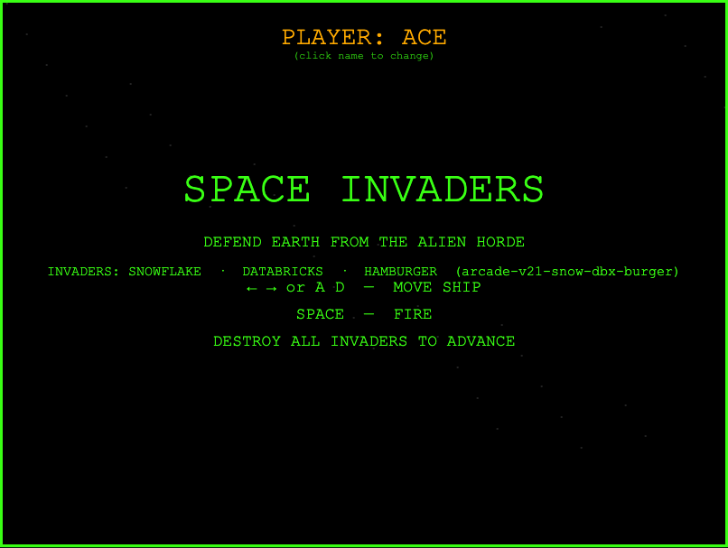
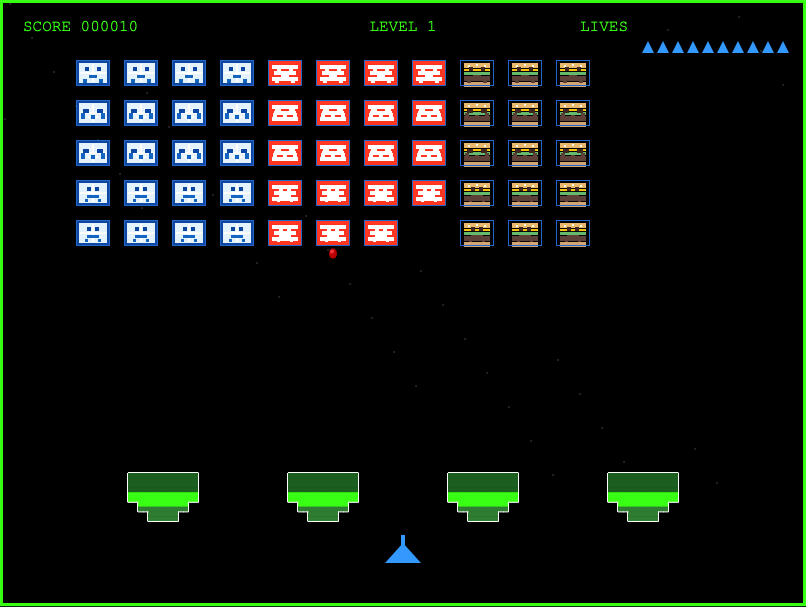
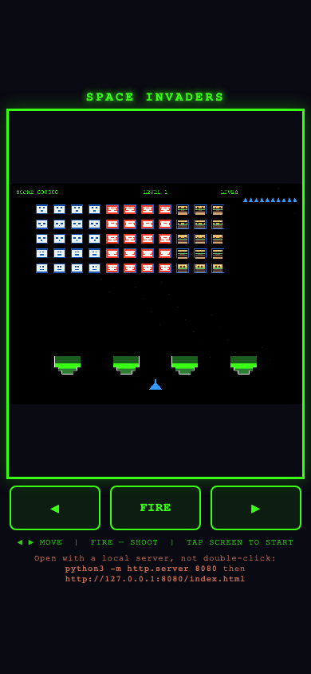
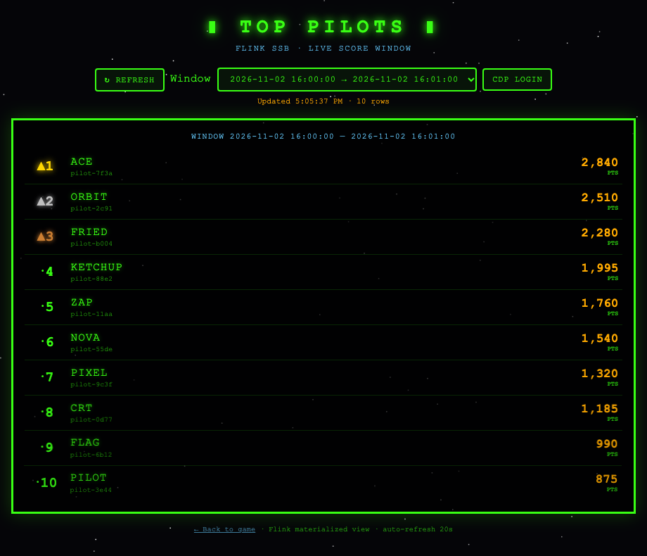

# Space Invaders — Arcade Edition

<p align="center">
  
</p>

<p align="center">
  <strong>Classic arcade action in the browser</strong> — HTML5 Canvas, vanilla JavaScript, no build step.
</p>

<p align="center">
  Invaders are pixel <strong>snowflakes</strong>, <strong>Databricks</strong> bricks, and <strong>hamburgers</strong>; you fire pixel-art <strong>french fries</strong>; they shoot <strong>ketchup</strong>. Green CRT vibes included.
</p>

---

## Screenshots

| Start screen | In play |
|:---:|:---:|
|  |  |

<p align="center">
  
  <br>
  <em>Mobile / iPhone — full viewport, safe areas, on-screen ◀ FIRE ▶ controls</em>
</p>

---

## Quick start

**Fastest:** double-click [`index.html`](index.html) or open it in any modern browser. Hard-refresh (`Cmd+Shift+R` / `Ctrl+Shift+R`) if assets look stale.

**Recommended** (NiFi / CORS testing) — from the repo root:

```bash
python3 -m http.server 8080
```

Then open [http://localhost:8080/index.html](http://localhost:8080/index.html).

> **404?** Start the server in the folder that contains `index.html`.

Mac setup notes: [sync-local-mac.md](./sync-local-mac.md)

**Build tag:** `arcade-v21-snow-dbx-burger` (shown on the start screen).

---

## How to play

### Desktop (keyboard)

| Control | Action |
|---------|--------|
| `←` `→` or `A` `D` | Move ship left / right |
| `Space` (or `↑` / `W`) | Fire |
| `Space` / `Enter` | Start game / Restart after game over |

### Mobile / iPhone (touch)

| Control | Action |
|---------|--------|
| **◀** / **▶** buttons | Move ship left / right |
| **FIRE** button | Shoot |
| Tap game screen | Start / Restart |
| Tap **PLAYER** name on intro | Change pilot name |

On iPhone Safari the game fills the viewport (portrait or landscape), respects safe areas, and uses on-screen controls.

### iPhone standalone (Add to Home Screen)

Install like a mini app: open the game in **Safari** from an **http(s) URL** (hosted site or your Mac’s LAN IP — not `file://`), then **Share → Add to Home Screen**. Launch from the icon for full-screen play with touch controls.

**Hosted example:**

```text
https://frothkoetter.github.io/space-invaders-arcade/index.html
```

**Same Wi‑Fi as Mac** (`python3 -m http.server 8080 --bind 0.0.0.0`, then use `http://YOUR_MAC_LAN_IP:8080/index.html` on the phone).

Step-by-step, NiFi bookmarks, and troubleshooting: [iphone-standalone.md](./iphone-standalone.md).

### Rules

- Destroy all invaders to advance to the next level.
- Invaders speed up as their numbers drop.
- Green bunkers absorb shots; they erode pixel by pixel.
- **10 lives** — lose them all and it's game over.
- Score: top row 30 pts, middle 20 pts, bottom 10 pts.

---

## Player name

On first visit the game prompts for a pilot name (**PLAYER: {NAME}** on the intro — click to change). Events include `playerId` and `playerName`.

---

## Event streaming (console mock)

Enable structured JSON events in DevTools:

```text
index.html?events=1
```

Or persist: `localStorage.setItem('si-events', '1')`.

Schema reference: [kafka-streaming-proposal.md](./kafka-streaming-proposal.md) (event shapes only; default transport is **NiFi ListenHTTP**, not Kafka).

---

## NiFi ListenHTTP export (primary)

When NiFi mode is on, the game **POST**s JSON to your Apache NiFi 2 **ListenHTTP** URL. Default browser mode is **`simple`** (`Content-Type: text/plain` + JSON body, no CORS preflight) — see [nifi-browser-cors.md](./nifi-browser-cors.md).

| Doc | Purpose |
|-----|---------|
| [enable-nifi-events.md](./enable-nifi-events.md) | Query params, bookmarks, localStorage |
| [nifi-listenhttp-setup.md](./nifi-listenhttp-setup.md) | ListenHTTP, CORS, curl |
| [nifi-browser-cors.md](./nifi-browser-cors.md) | Browser POST vs proxy |
| [nifi-iceberg-ingest-flow.md](./nifi-iceberg-ingest-flow.md) | NiFi → Iceberg (CDP) |
| [trino-iceberg-space-invaders.ddl](./trino-iceberg-space-invaders.ddl) | Trino DDL |
| [hive-iceberg-space-invaders.ddl](./hive-iceberg-space-invaders.ddl) | Hive DDL samples |

### One-shot URL (no local `http.server`)

Open the game from **any HTTPS/HTTP origin** (GitHub Pages, CDN, NiFi-served static files, etc.). Paste **one full URL** in the address bar — settings are saved to `localStorage` on first load.

**Replace** `YOUR_GAME_ORIGIN/index.html` with where you host this repo (example below uses GitHub Pages for [space-invaders-arcade](https://github.com/frothkoetter/space-invaders-arcade) — enable **Pages → Deploy from branch `main` / root** if that URL is not live yet). **Replace** the `nifi-url` value with your ListenHTTP endpoint (projtriton example uses **http** on port **9088**, not https).

```text
https://frothkoetter.github.io/space-invaders-arcade/index.html?nifi=1&events=1&nifi-mode=simple&nifi-url=http://projtriton.inbound.dfx.hahgzjod.a465-9q4k.cloudera.site:9088/space-invaders
```

| Query param | Purpose |
|-------------|---------|
| `nifi=1` | Enable NiFi POST export (persisted as `si-nifi`) |
| `events=1` | Log `[game-event]` JSON in DevTools (persisted as `si-events`) |
| `nifi-url` | Full ListenHTTP URL (persisted as `si-nifi-listen-url`) |
| `nifi-mode` | `simple` (default, cross-origin friendly) or `cors` (`application/json`, needs gateway CORS) |

After the first visit you can open `https://YOUR_GAME_ORIGIN/index.html` only — NiFi settings remain until you clear site data.

> **Do not use `file://`** (double-click `index.html`) for NiFi export: the page origin is null and POST behavior is unreliable. Use a hosted URL or a local server.

**ListenHTTP ingest URL only** (for NiFi processor config or `curl`, not the game page):

```text
http://projtriton.inbound.dfx.hahgzjod.a465-9q4k.cloudera.site:9088/space-invaders
```

Local dev ListenHTTP default in the game: `http://127.0.0.1:9998/space-invaders`

**localStorage keys:** `si-nifi`, `si-nifi-listen-url`, `si-nifi-mode`, `si-events`, `si-player-name`

Example curl:

```bash
./curl-smoke-test.sh
```

Simulate many players: `./simulate-players-nifi.sh`

---

## Top 10 leaderboard (optional)

Flink SSB-backed ranking UI: [top10-leaderboard.html](./top10-leaderboard.html) — see [top10-leaderboard.md](./top10-leaderboard.md). Requires `SSB_USER` / `SSB_PASSWORD` when using [serve-with-nifi-proxy.py](./serve-with-nifi-proxy.py).

<p align="center">
  
  <br>
  <em>Sample rankings (screenshot uses mock data; live page reads Flink SSB <code>top10player</code>)</em>
</p>

---

## Dev tools in this repo

| File | Purpose |
|------|---------|
| `serve-with-nifi-proxy.py` | Same-origin proxy for NiFi POST and SSB GET |
| `simulate-players-nifi.py` / `.sh` | Synthetic game events to NiFi |
| `curl-smoke-test.sh` | One-shot ingest smoke test |

---

## License

MIT — see [LICENSE](./LICENSE).

---

## Not included on GitHub

The optional ~2.7 MB `kafka-browser-producer.js` bundle and `scripts/node_modules` are omitted to keep the repo small. See [public-kafka-ingest.md](./public-kafka-ingest.md) for historical Kafka notes.
