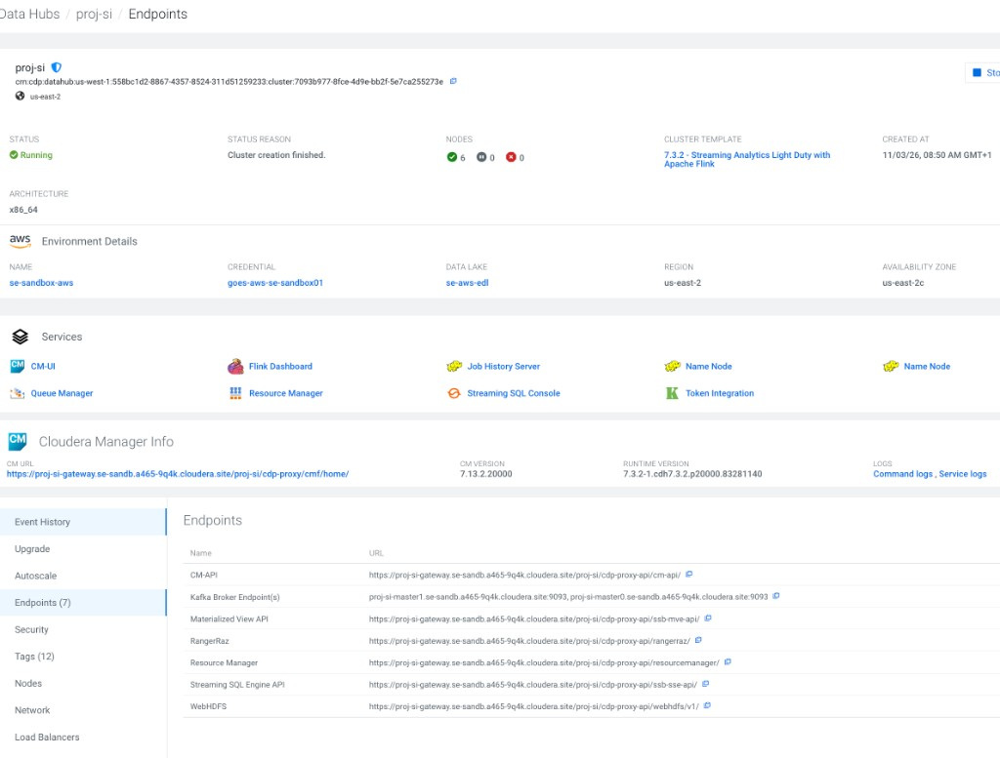
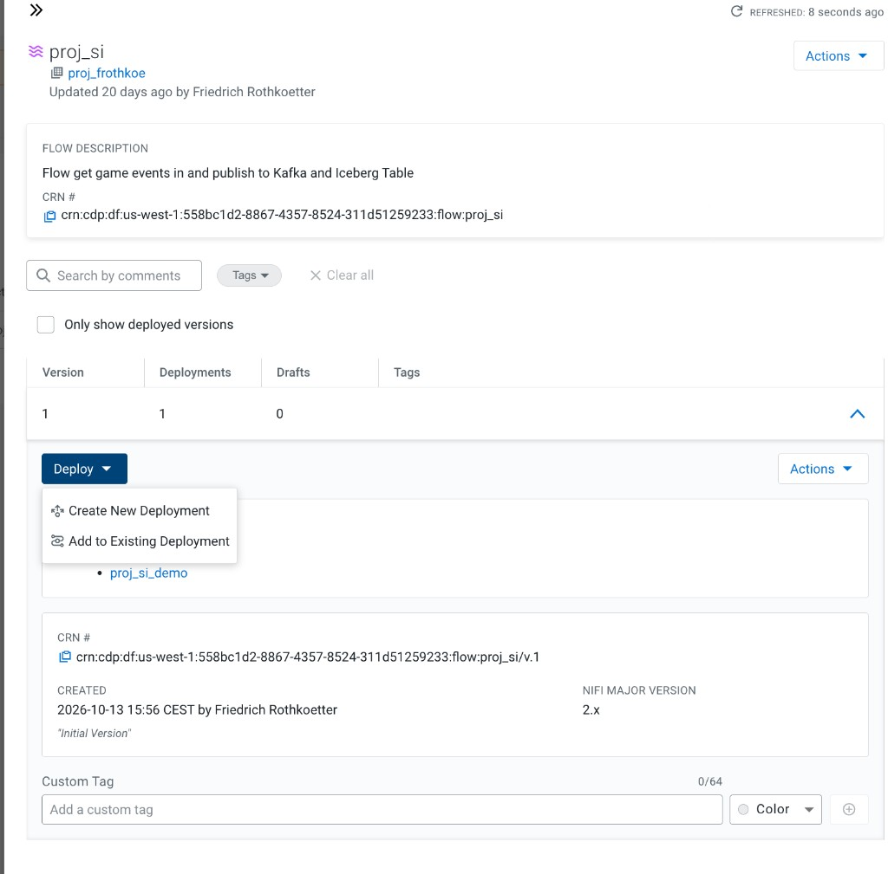
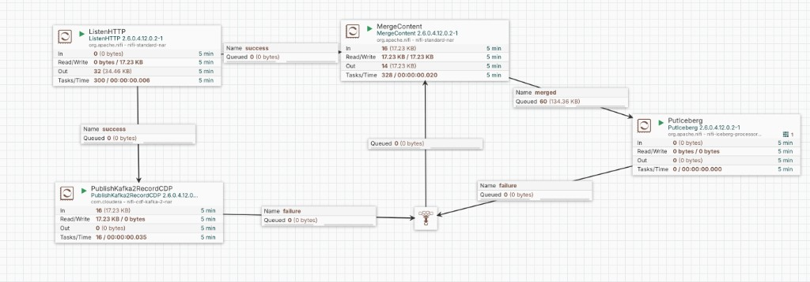
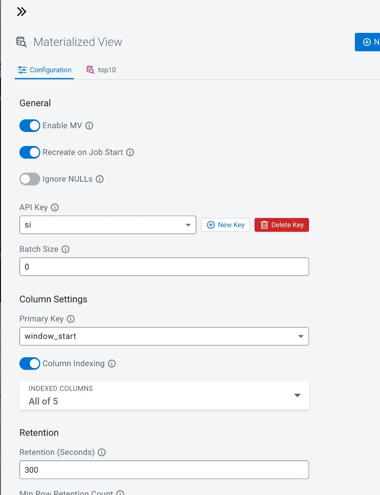
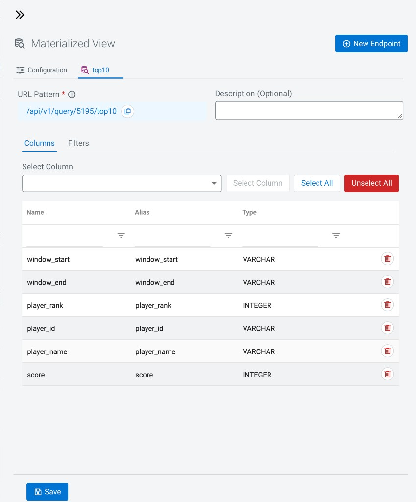

# Full CDP setup — Space Invaders (proj-si reference)

End-to-end sequence: **Data Hub (Kafka + SSB)** → **CDW Trino (Iceberg)** → **CDF NiFi ingest** → **browser game** → **Flink leaderboard MV** → **local leaderboard UI**.

Replace hostnames with your tenant if they differ. Example cluster: **`proj-si`**, DataFlow flow **`proj_si`**.

| Artifact | Repo path |
|----------|-----------|
| NiFi flow export | [nifi-flows/proj_si-version-1.json](./nifi-flows/proj_si-version-1.json) |
| NiFi flow guide | [nifi-flow-proj-si.md](./nifi-flow-proj-si.md) |
| Iceberg DDL | [trino-iceberg-space-invaders.ddl](./trino-iceberg-space-invaders.ddl) |
| Flink Kafka + MV SQL | [flink-top10player-mv.sql](./flink-top10player-mv.sql) · [flink-kafka-data-source.md](./flink-kafka-data-source.md) |
| Game + proxy | [index.html](./index.html) · [serve-with-nifi-proxy.py](./serve-with-nifi-proxy.py) · [top10-leaderboard.html](./top10-leaderboard.html) |

---

## 1 — Create Data Hub (Streaming Analytics)

1. In **CDP Management Console** → **Data Hub Clusters** → **Create Data Hub**.
2. Choose template **7.3.x — Streaming Analytics Light Duty with Apache Flink** (or your supported streaming template).
3. Name the cluster (example: **`proj-si`**), attach your **Data Lake**, pick region/VPC, create.
4. Wait until status is **Running** (cluster creation finished).



### 1.1 Copy endpoints you need later

Open the cluster → **Endpoints** tab:

| Use | Example (proj-si) |
|-----|-------------------|
| **Kafka brokers** (NiFi parameter `Kafka Brokers`) | `proj-si-master1.se-sandb.a465-9q4k.cloudera.site:9093, proj-si-master0.se-sandb.a465-9q4k.cloudera.site:9093` |
| **Streaming SQL Console** | Open from Endpoints → build SSB jobs here |
| **Materialized View API** (gateway base) | `https://proj-si-gateway.se-sandb.a465-9q4k.cloudera.site/proj-si/cdp-proxy-api/ssb-mve-api/` |
| **Streaming SQL Engine API** | `https://proj-si-gateway.se-sandb.a465-9q4k.cloudera.site/proj-si/cdp-proxy-api/ssb-sse-api/` |

Keep the **Kafka broker list** — you will paste it into the NiFi parameter context **`proj_si`**.

---

## 2 — Create CDW (Trino) and Iceberg table

1. **Data Warehouse** → create environment / **Trino** edition (CDW) linked to the same datalake.
2. Open **Hue** or **Trino** SQL editor connected to the **`iceberg`** catalog (or your Iceberg catalog name).
3. Run DDL from [trino-iceberg-space-invaders.ddl](./trino-iceberg-space-invaders.ddl):

```sql
CREATE SCHEMA IF NOT EXISTS iceberg.space_invaders;

-- then CREATE TABLE iceberg.space_invaders.space_invaders_events ( ... );
```

4. Verify:

```sql
SHOW TABLES IN iceberg.space_invaders;
DESCRIBE iceberg.space_invaders.space_invaders_events;
```

NiFi **PutIceberg** must use **Catalog Namespace** **`space_invaders`** and **Table Name** **`space_invaders_events`** (fixed in repo export [proj_si-version-1.json](./nifi-flows/proj_si-version-1.json)).

---

## 3 — CDF DataFlow: deploy NiFi flow `proj_si`

### 3.1 Flow catalog

In **DataFlow** → flow **`proj_si`** (description: ingest game events → Kafka + Iceberg).



- **Deploy** → **Create New Deployment** (or add to existing, e.g. `proj_si_demo`).
- Enable **Allow data ingest** / inbound access per your CDP DataFlow deployment wizard.
- Note the **public inbound URL** and **ListenHTTP port** (commonly **9088**) and path **`/space-invaders`**.

Example inbound (replace with your deployment):

```text
http://projsidemo.inbound.dfx.ssgxyp6r.a465-9q4k.cloudera.site:9088/space-invaders
```

Must be **`http://`** on **9088** (not `https://` on 9088).

### 3.2 Parameter context `proj_si`

| Parameter | Set to |
|-----------|--------|
| `Listening Port` | Inbound port (e.g. **9088**) |
| `Kafka Brokers` | Broker list from **step 1.1** |
| `cdp_workload_user` | CDP workload user (Kafka + Kerberos for Iceberg) |
| `cdp_workload_password` | *(sensitive — set in UI only)* |
| `CDPEnvironment` | Hadoop config resources asset for **HiveCatalogService** |

Import or sync flow from [nifi-flows/proj_si-version-1.json](./nifi-flows/proj_si-version-1.json) if needed — see [nifi-flow-proj-si.md](./nifi-flow-proj-si.md).

### 3.3 Enable controller services → start processors

1. Enable **JsonTreeReader-space_invaders**, **JsonRecordSetWriter**, **HiveCatalogService**, **KerberosPasswordUserService**, Kafka **SSL Context**.
2. Start **ListenHTTP**, **MergeContent**, **PutIceberg**, **PublishKafka2RecordCDP**.
3. Canvas should show **green** (running); **ListenHTTP** should emit FlowFiles on POST.



**Sanity:** [curl-smoke-test.sh](./curl-smoke-test.sh) with `NIFI_URL` set to your inbound URL.

**Troubleshooting PutIceberg:** If FlowFiles queue on **PutIceberg** with warnings, confirm Iceberg table exists (step 2), namespace **`space_invaders`**, and Kerberos/HMS connectivity.

---

## 4 — Play the game → NiFi → Kafka + Iceberg

### 4.1 Browser URL (NiFi enabled)

Use **HTTP** game origin (not `file://`). Examples:

**GitHub Pages** (requires HTTPS→HTTP workaround — prefer local proxy below):

```text
https://frothkoetter.github.io/space-invaders-arcade/index.html?nifi=1&events=1&nifi-mode=simple&nifi-url=http://YOUR_INBOUND_HOST:9088/space-invaders
```

**Recommended — local proxy** (same-origin POST):

```bash
export NIFI_UPSTREAM='http://projsidemo.inbound.dfx.ssgxyp6r.a465-9q4k.cloudera.site:9088/space-invaders'
python3 serve-with-nifi-proxy.py
```

```text
http://127.0.0.1:8080/index.html?nifi=1&events=1&nifi-mode=simple&nifi-url=http://127.0.0.1:8080/space-invaders
```

Enter pilot name, **start game**, shoot invaders (`events=1` → `[game-event]` in DevTools).

### 4.2 Verify in NiFi

- **ListenHTTP**: Out ↑ on success.
- **PublishKafka2RecordCDP**: In/Out ↑, topic **`space_invaders_events`**.
- **PutIceberg**: In ↑, commits to **`space_invaders.space_invaders_events`**.

### 4.3 Verify downstream

- **Kafka:** consume topic `space_invaders_events` (or wait for SSB job).
- **Trino:**

```sql
SELECT count(*) FROM iceberg.space_invaders.space_invaders_events;
SELECT event_type, count(*) FROM iceberg.space_invaders.space_invaders_events GROUP BY 1;
```

---

## 5 — Flink SQL Stream Builder (SSB)

### 5.1 Kafka data source `local`

Streaming SQL Studio → **Data Sources** → **Kafka Data Source**:

- Name: **`local`**
- Brokers: *(from step 1.1)*
- Protocol: **SASL/SSL**, **PLAIN**, default truststore, workload user/password

Details: [flink-kafka-data-source.md](./flink-kafka-data-source.md)

### 5.2 Virtual table `space_invaders_events`

**Kafka Table** on cluster **`local`**, topic **`space_invaders_events`**, format **JSON**, detect schema, **Event Time** + watermark (see [flink-top10player-mv.sql](./flink-top10player-mv.sql) Step 1).

Qualified name: `` `ssb`.`ssb_default`.`space_invaders_events` ``.

### 5.3 Job — leaderboard SQL (HOP window)

Create a **Flink SQL** job; paste **Step 2** from [flink-top10player-mv.sql](./flink-top10player-mv.sql):

- **HOP** window: **1 hour** size, **1 minute** slide
- Top **10** by max **`newScore`** on **`score.changed`**
- SQL object name can be `top10player`; SSB **MV endpoint name** can be **`top10`** (next step)

Start the job; confirm **RUNNING**.

---

## 6 — Materialized View API `top10`

In the SQL job → **Materialized View** → **Configuration**:



| Setting | Example |
|---------|---------|
| Enable MV | ON |
| Recreate on Job Start | ON |
| API Key | e.g. **`si`** |
| Primary Key | **`window_start`** |
| Column Indexing | ON |
| Retention | tune (e.g. **300** seconds) |

**Endpoint tab `top10`** — expose columns:

`window_start`, `window_end`, `player_rank`, `player_id`, `player_name`, `score`



Save. Example REST URL (proj-si):

```text
https://proj-si-gateway.se-sandb.a465-9q4k.cloudera.site/proj-si/cdp-proxy-api/ssb-mve-api/api/v1/query/5195/top10?key=57897915-994d-480f-b762-e4f986d38d27&limit=100
```

Example response shape (1-hour windows sliding each minute):

```json
{"window_start":"2026-11-03 08:51:00.000","window_end":"2026-11-03 09:51:00.000","player_rank":"1","player_id":"anon-92718e43","player_name":"Friedrich","score":"560"}
```

Query id **`5195`** and API **key** are per job/environment — copy from your SSB UI.

---

## 7 — Local leaderboard application

```bash
export SSB_USER='your-cdp-user'
export SSB_PASSWORD='your-cdp-password'
# optional override:
# export SSB_UPSTREAM='https://proj-si-gateway.../api/v1/query/5195/top10?key=YOUR_KEY'
export NIFI_UPSTREAM='http://YOUR_INBOUND:9088/space-invaders'
python3 serve-with-nifi-proxy.py
```

Open:

```text
http://127.0.0.1:8080/top10-leaderboard.html
http://127.0.0.1:8080/leaderboard
```

The page calls **`GET /api/ssb/top10?limit=100`** (proxied with Basic auth). Direct mode: `?proxy=0` and **CDP LOGIN** if CORS allows (often use proxy).

Play again at:

```text
http://127.0.0.1:8080/index.html?nifi=1&nifi-url=http://127.0.0.1:8080/space-invaders
```

Refresh leaderboard — ranks should update within ~1 minute as **`score.changed`** events flow Kafka → Flink.

More: [top10-leaderboard.md](./top10-leaderboard.md)

---

## Quick reference

| Layer | Name |
|-------|------|
| Kafka topic | `space_invaders_events` |
| Iceberg table | `iceberg.space_invaders.space_invaders_events` |
| NiFi ListenHTTP path | `/space-invaders` |
| NiFi PutIceberg | `space_invaders` / `space_invaders_events` |
| SSB Kafka source | `local` |
| SSB MV endpoint | `top10` (query id varies, e.g. **5195**) |
| Game build tag | `arcade-v21-snow-dbx-burger` |

---

## Related troubleshooting

- Browser NiFi POST blocked from HTTPS Pages → [nifi-browser-cors.md](./nifi-browser-cors.md)
- iPhone / standalone → [iphone-standalone.md](./iphone-standalone.md)
- NiFi ListenHTTP / CORS → [nifi-listenhttp-setup.md](./nifi-listenhttp-setup.md)
