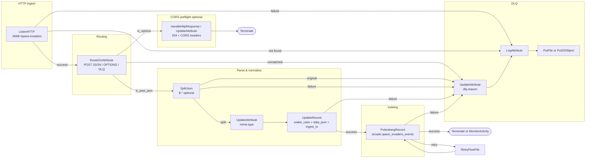

# NiFi 2 — Space Invaders HTTP → Iceberg (full flow description)

Canonical operator reference for the **Arcade Space Invaders** ingest pipeline on **Cloudera DataFlow (NiFi 2)** in Kubernetes. Shorter checklist companion: [nifi-iceberg-ingest-flow.md](./nifi-iceberg-ingest-flow.md).

**NiFi UI (cluster):** `https://dfx-nifi-0…:8443` (replace with your pod FQDN from CDP DataFlow).

**Process group name (suggested):** `space-invaders-ingest-iceberg`

---

## 1. Overview

### Purpose

Browser game clients call **`publishGameEvent`** in [`index.html`](./index.html), which **POST**s JSON event envelopes to NiFi **ListenHTTP**. NiFi validates and normalizes each event, then **appends** rows to Apache **Iceberg** table **`iceberg.arcade.space_invaders_events`**, queryable from **Trino**.

### Public ingest URL (Cloudera inbound)

```text
http://projtriton.inbound.dfx.hahgzjod.a465-9q4k.cloudera.site:9088/space-invaders
```

| Item | Value |
|------|--------|
| Scheme | **HTTP** on port **9088** (plain text; do not use `https://` — TLS handshake fails with curl error 35) |
| Port | **9088** |
| Path | **`/space-invaders`** |
| Method | **POST** only (game); **OPTIONS** may appear for CORS preflight |
| Content-Type | **`application/json`** |

Local dev default in the game (override via localStorage): `http://127.0.0.1:9998/space-invaders`.

### Data path (logical)

```text
Browser (publishGameEvent)
  → HTTP POST JSON
  → Cloudera inbound (projtriton…:9088)
  → NiFi ListenHTTP (/space-invaders)
  → RouteOnAttribute (POST+JSON | OPTIONS | DLQ)
  → SplitJson ($.*) OR single-object bypass
  → UpdateAttribute (mime.type)
  → UpdateRecord (camelCase → snake_case, data → data_json, ingest_ts)
  → PutIcebergRecord
  → Iceberg: iceberg.arcade.space_invaders_events (PARQUET)
  → Trino: SELECT … FROM iceberg.arcade.space_invaders_events
```

### Game / curl JSON (snake_case — same as Hive DDL + Avro)

| Field | Type | Notes |
|-------|------|--------|
| `event_id` | string (UUID) | Idempotency key |
| `event_type` | string | e.g. `invader.killed` — **string**, not Avro enum |
| `occurred_at` | string (ISO-8601) | Event time |
| `session_id` | string | Browser session |
| `player_id` | string | Stable anonymous id (`anon-…`) |
| `player_name` | string | Display name (max 24 chars) |
| `game_version` | string | e.g. `flag-edition-v16-snakecase-ingest` |
| `level` | int | Current level |
| `frame` | long | Frame counter |
| `data_json` | string | `JSON.stringify` of event payload object |
| `ingest_ts` | string (optional) | Omit from client; NiFi may set at ingest |

Bodies are either **one JSON object** or a **JSON array** of objects (batched, up to **50** per request, flush every **500 ms**).

### Related artifacts

| Document / file | Role |
|-----------------|------|
| [trino-iceberg-space-invaders.ddl](./trino-iceberg-space-invaders.ddl) | Iceberg table DDL (snake_case columns) |
| [space-invaders-events.avsc](./space-invaders-events.avsc) | Iceberg / post-UpdateRecord Avro (snake_case) |
| [space-invaders-events-wire.avsc](./space-invaders-events-wire.avsc) | Wire camelCase (optional Schema Text for reader) |
| [nifi-jsontree-schema-text.json](./nifi-jsontree-schema-text.json) | Paste-ready JsonTreeReader Schema Text (wire shape) |
| [nifi-listenhttp-setup.md](./nifi-listenhttp-setup.md) | CORS, curl, local ListenHTTP |
| [nifi-validation-json-paths.md](./nifi-validation-json-paths.md) | Fix “No JSON paths were specified” |

---

## 2. Canvas diagram

### Mermaid (processors and relationships)



### ASCII (compact)

```text
                    ┌─────────────┐
                    │ ListenHTTP  │ :9088  /space-invaders
                    └──────┬──────┘
           success         │ failure / not found
              ┌────────────┴────────────┐
              ▼                         ▼
     ┌─────────────────┐         ┌──────────────┐
     │ RouteOnAttribute│         │ LogAttribute │──┐
     └────────┬────────┘         └──────────────┘  │
   is_post_json│ is_options │ unmatched            │
              ▼            ▼         ▼             │
     ┌────────────┐  ┌──────────┐  ┌──────────────┴──┐
     │ SplitJson  │  │ CORS 204 │  │ UpdateAttribute │
     │  ($.*)     │  │ (opt.)   │  │  dlq.reason   │
     └─────┬──────┘  └──────────┘  └────────┬────────┘
           │ split                         │
           ▼                               ▼
     ┌─────────────┐                  ┌─────────┐
     │UpdateAttribute│ mime.type      │ PutFile │
     └──────┬──────┘                  │ / S3 DLQ│
            ▼                         └─────────┘
     ┌─────────────┐
     │ UpdateRecord│ snake_case, data_json, ingest_ts
     └──────┬──────┘
            ▼
     ┌─────────────────┐
     │ PutIcebergRecord│ → iceberg.arcade.space_invaders_events
     └─────────────────┘
```

**Single-object bypass:** wire `ListenHTTP → RouteOnAttribute → UpdateAttribute → UpdateRecord → PutIcebergRecord` (omit **SplitJson**).

---

## 3. Controller services

Create these at **Process Group** or **Controller** scope. **Enable order:** SSL (if used by ListenHTTP) → **JsonTreeReader** / **JsonRecordSetWriter** → **IcebergCatalogService**. Do **not** start **ListenHTTP** until all referenced services show **Enabled**.

### 3.1 StandardSSLContextService (HTTPS)

Use when NiFi terminates TLS on ListenHTTP, or when your CDP pattern requires an explicit SSL context on the processor.

| Property | Value / guidance |
|----------|------------------|
| **Type** | `StandardRestrictedSSLContextService` or CDP-provided SSL service |
| **Keystore Location / Password** | Per Cloudera DataFlow / inbound keystore docs |
| **Keystore Type** | `PKCS12` or `JKS` (match your cert bundle) |
| **Truststore Location / Password** | Platform truststore |
| **SSL Protocol** | `TLS` (default) |

For **`projtriton.inbound.dfx…:9088`**, the public listener is **plain HTTP** (verified: `https://` returns SSL “wrong version number” / “protocol version”; `http://` returns **200**). NiFi **ListenHTTP** uses **no SSL Context Service** on that binding unless your tenant docs say otherwise.

### 3.2 JsonTreeReader (wire / pre-UpdateRecord)

Reads **camelCase** JSON from the game **before** **UpdateRecord**.

| Property | Value |
|----------|--------|
| **Type** | `JsonTreeReader` |
| **Schema Access Strategy** | **`Use 'Schema Text' Property`** (recommended) or **`Infer Schema`** (smoke tests only) |
| **Schema Text** | Paste full contents of [nifi-jsontree-schema-text.json](./nifi-jsontree-schema-text.json) **or** [space-invaders-events-wire.avsc](./space-invaders-events-wire.avsc) |
| **Schema Access Strategy** | **Do not** use **Use JSON Paths** without adding paths — see [nifi-validation-json-paths.md](./nifi-validation-json-paths.md) |
| **Date Format** | (empty or ISO-8601) |
| **Time Format** | (empty or ISO-8601) |
| **Timestamp Format** | ISO-8601 for `occurredAt` |
| **Allow Comments** | `false` |

**Important:** `eventType` values like `invader.killed` must be **`string`**, never Avro **enum** (enum symbols cannot contain `.`).

The wire schema in `nifi-jsontree-schema-text.json` lists top-level fields only; the game still sends **`data` as a JSON object**. **Infer Schema** or explicit handling in **UpdateRecord** must stringify `data` → `data_json`.

### 3.3 JsonRecordSetWriter (post-UpdateRecord)

Used as **Record Writer** on **UpdateRecord** so output matches Iceberg column names.

| Property | Value |
|----------|--------|
| **Type** | `JsonRecordSetWriter` |
| **Schema Write Strategy** | **`Use 'Schema Text' Property`** |
| **Schema Text** | Paste [space-invaders-events.avsc](./space-invaders-events.avsc) (snake_case + `data_json` + optional `ingest_ts`) |
| **Output Grouping** | `One Line Per Object` (typical) |
| **Pretty Print JSON** | `false` |

Alternative: **AvroRecordSetWriter** with the same **Schema Text** if your NiFi Iceberg bundle prefers Avro record streams.

### 3.4 IcebergCatalogService

| Property | Example / placeholder |
|----------|------------------------|
| **Type** | `IcebergCatalogService` |
| **Catalog Type** | `HIVE` (Hive Metastore) **or** `REST` |
| **Catalog Name** | `iceberg` (align with Trino catalog) |
| **Hive Metastore URI** | `thrift://YOUR_HMS_HOST:9083` (when `HIVE`) |
| **Warehouse Location** | `YOUR_WAREHOUSE` e.g. `s3a://bucket/warehouse` or `hdfs://…/warehouse` |
| **REST Catalog URI** | `https://YOUR_ICEBERG_REST/…` (when `REST`) |
| **Hadoop Configuration Resources** | `core-site.xml`, `hdfs-site.xml` (CDP NiFi classpath) |
| **Kerberos** | Principal + keytab per CDP secured cluster docs |

Enable only after connectivity from **`dfx-nifi-0`** to HMS / object store is verified.

### Controller service enable checklist

| Step | Action |
|------|--------|
| 1 | Create **JsonTreeReader** + **JsonRecordSetWriter** (+ **SSL** if needed) |
| 2 | Create **IcebergCatalogService**, verify HMS/REST + warehouse |
| 3 | **Enable** JsonTreeReader, JsonRecordSetWriter, SSL, IcebergCatalogService |
| 4 | Run **Perform Validation** on the process group |
| 5 | **Start** processors (ListenHTTP last) |

---

## 4. Processors (in order)

Default **scheduling** unless noted:

| Setting | Typical value |
|---------|----------------|
| **Scheduling Strategy** | `TIMER_DRIVEN` for ListenHTTP (keeps HTTP server alive); `EVENT_DRIVEN` or `TIMER_DRIVEN` `0 sec` for downstream |
| **Concurrent Tasks** | See per-processor tables |
| **Run Duration** | `0 ms` |
| **Execution** | `ALL` nodes (CDP) — confirm single ListenHTTP binding per port in your deployment |

**Bulletin / backpressure:** see [§13 Operations](#13-operations).

---

### 4.1 ListenHTTP

| Property | Value |
|----------|--------|
| **Processor type** | `ListenHTTP` |
| **Listening Port** | **`9088`** (must match Cloudera inbound and game `si-nifi-listen-url`) |
| **Base Path** | **`/space-invaders`** |
| **HTTP Methods Allowed** | **`POST`** (add **`OPTIONS`** only if you handle CORS inside NiFi instead of at the gateway) |
| **SSL Context Service** | Enabled SSL service **or** none if TLS terminates before NiFi |
| **Return Code** | **`200`** |
| **HTTP Context Map** | (default) |
| **Multipart Request Max Size** | **`0 B`** or leave default to **disable / reject multipart** — game sends raw JSON body, not multipart |
| **Multipart Read Buffer Size** | (default; irrelevant if multipart off) |
| **Allow POST / PUT / PATCH with body** | Allow POST (default) |
| **Client Authentication** | `No Authentication` (open ingest) or `Required` if using mTLS at NiFi |
| **Authorized DN Pattern** | Empty for open ingest |
| **Max Data to Receive per Second** | `1 MB` – `10 MB` (tune for arcade traffic) |
| **Max Unconfirmed Flow File Time** | (default) |
| **Health Check Path** | *(optional)* e.g. `/space-invaders/health` — only if your CDP inbound health probes require it; game does **not** call this |

| Scheduling | Value |
|------------|--------|
| **Scheduling Strategy** | `TIMER_DRIVEN` |
| **Run Schedule** | `0 sec` |
| **Concurrent Tasks** | **`1`** minimum; increase (e.g. **`2`–`4`**) only if your NiFi version docs allow parallel request handling on the same port — validate under load |

| Relationship | Connection |
|--------------|------------|
| **success** | → **RouteOnAttribute** |
| **failure** | → **LogAttribute** (DLQ) → **PutFile** / **PutS3Object** |
| **not found** | → same DLQ as **failure** (wrong path/method from clients) |

---

### 4.2 RouteOnAttribute

Separates valid **POST JSON** from **OPTIONS** (CORS) and everything else (DLQ).

| Property | Value |
|----------|--------|
| **Processor type** | `RouteOnAttribute` |
| **Routing Strategy** | `Route to Property name` |

Dynamic / named properties (adjust attribute names to your ListenHTTP version):

| Property name | Expression (example) |
|---------------|----------------------|
| **is_post_json** | `${http.method:equals('POST'):and(${mime.type:contains('json')})}` |
| **is_options** | `${http.method:equals('OPTIONS')}` |

If `mime.type` is empty, add upstream **UpdateAttribute**: `mime.type` = `${http.headers.content.type:trim()}` or infer from ListenHTTP attributes.

| Scheduling | Value |
|------------|--------|
| **Concurrent Tasks** | `1` – `4` |

| Relationship | Connection |
|--------------|------------|
| **is_post_json** | → **SplitJson** (or → **UpdateAttribute** if bypassing split) |
| **is_options** | → optional **HandleHttpResponse** / **UpdateAttribute** + CORS headers → terminate |
| **unmatched** | → **UpdateAttribute** (`dlq.reason` = `unmatched_route`) → DLQ |

---

### 4.3 SplitJson (recommended for batched arrays)

| Property | Value |
|----------|--------|
| **Processor type** | `SplitJson` |
| **JSON Paths** (dynamic — **Add Property +**) | **`$.*`** (property label often `split`) |
| **Array Output Strategy** | `split` |

| Scheduling | Value |
|------------|--------|
| **Concurrent Tasks** | `1` – `8` |

| Relationship | Connection |
|--------------|------------|
| **split** | → **UpdateAttribute** (`mime.type`) |
| **original** | → DLQ (unexpected root shape) |
| **failure** | → DLQ |

**Bypass:** For curl-only or single-object traffic, connect **is_post_json** directly to **UpdateAttribute** → **UpdateRecord**.

**Validation:** Empty **JSON Paths** causes *No JSON paths were specified* on **Perform Validation** — see [nifi-validation-json-paths.md](./nifi-validation-json-paths.md).

---

### 4.4 UpdateAttribute (mime.type)

| Property | Value |
|----------|--------|
| **Processor type** | `UpdateAttribute` |
| **mime.type** | `application/json` |

| Relationship | Connection |
|--------------|------------|
| **success** | → **UpdateRecord** |
| **failure** | → DLQ |

---

### 4.5 UpdateRecord (camelCase → snake_case, data_json, ingest_ts)

| Property | Value |
|----------|--------|
| **Processor type** | `UpdateRecord` |
| **Record Reader** | Controller **`JsonTreeReader`** (wire / camelCase) |
| **Record Writer** | Controller **`JsonRecordSetWriter`** (snake_case Avro schema) |
| **Replacement Value Strategy** | `Record Path` (or `Literal Values` where noted) |

**Field mapping** (RecordPath replacements — configure as **UpdateRecord** dynamic properties per NiFi 2 UI):

| Source (wire) | Target (Iceberg) | Transformation |
|---------------|------------------|----------------|
| `/eventId` | `/event_id` | move/rename |
| `/eventType` | `/event_type` | move/rename |
| `/occurredAt` | `/occurred_at` | move/rename (timestamp string) |
| `/sessionId` | `/session_id` | move/rename |
| `/playerId` | `/player_id` | move/rename |
| `/playerName` | `/player_name` | move/rename |
| `/gameVersion` | `/game_version` | move/rename |
| `/level` | `/level` | copy |
| `/frame` | `/frame` | copy |
| `/data` | `/data_json` | **stringify** JSON object → VARCHAR (use record function or `Attribute` + `recordPath` per your NiFi version, e.g. serialize `data` map to string) |
| *(literal)* | `/ingest_ts` | `${now():format('yyyy-MM-dd'T'HH:mm:ss.SSS'Z'','UTC')}` or processor ingest timestamp |

Remove or null out leftover camelCase fields if your writer schema is strict.

| Scheduling | Value |
|------------|--------|
| **Concurrent Tasks** | `2` – `8` |

| Relationship | Connection |
|--------------|------------|
| **success** | → **PutIcebergRecord** |
| **failure** | → DLQ |

---

### 4.6 PutIcebergRecord

| Property | Value |
|----------|--------|
| **Processor type** | `PutIcebergRecord` |
| **Record Reader** | **`JsonTreeReader`** wired to **snake_case** schema **or** chain reader from **UpdateRecord** output (same **JsonRecordSetWriter** schema as [space-invaders-events.avsc](./space-invaders-events.avsc)) |
| **Iceberg Catalog Service** | Enabled **`IcebergCatalogService`** |
| **Namespace** | **`arcade`** |
| **Table Name** | **`space_invaders_events`** |
| **File Format** | **`PARQUET`** |
| **Maximum File Size** | `128 MB` (tune) |
| **Maximum Records per File** | `500000` (tune) |
| **Write Mode** | Append (default event stream) |
| **Identifier Field Names** | `event_id` *(optional — for upsert/dedup policies)* |
| **Unmatched Field Behavior** | `Ignore Unmatched Fields` or `Fail` (prefer **Fail** in prod after schema lock-in) |

Create table first with [trino-iceberg-space-invaders.ddl](./trino-iceberg-space-invaders.ddl); avoid relying on auto-create in production.

| Scheduling | Value |
|------------|--------|
| **Concurrent Tasks** | `1` – `4` (Iceberg commits are sensitive — start with **`1`**) |

| Relationship | Connection |
|--------------|------------|
| **success** | Terminate or **MonitorActivity** |
| **failure** | → **UpdateAttribute** (`dlq.reason` = `${puticeberg.failure.reason:append('…')}`) → DLQ |
| **retry** | → **RetryFlowFile** (transient HMS/S3) → **PutIcebergRecord** |

**Trino qualified name:** `iceberg.arcade.space_invaders_events`

---

## 5. ListenHTTP (detailed)

| Requirement | Setting |
|-------------|---------|
| Port | **9088** |
| Base path | **`/space-invaders`** |
| Full public URL | `http://projtriton.inbound.dfx.hahgzjod.a465-9q4k.cloudera.site:9088/space-invaders` |
| Methods | **POST** for ingest; **OPTIONS** only if routed for CORS |
| Multipart | **Off** / zero max — JSON body only |
| Health check | Optional **Health Check Path** for K8s probes — not used by the game |
| Response | **HTTP 200** on success (game uses fire-and-forget `fetch`; errors only in DevTools console) |

**Game localStorage (CDP):**

```javascript
localStorage.setItem('si-nifi', '1')
localStorage.setItem('si-nifi-listen-url', 'http://projtriton.inbound.dfx.hahgzjod.a465-9q4k.cloudera.site:9088/space-invaders')
```

---

## 6. RouteOnAttribute (POST JSON vs OPTIONS vs DLQ)

| Route | Condition | Destination |
|-------|-----------|-------------|
| **is_post_json** | POST and JSON content type | Split / normalize pipeline |
| **is_options** | OPTIONS | Return **204** with CORS headers (optional processor) or DLQ if gateway handles CORS |
| **unmatched** | GET, wrong content-type, etc. | DLQ + **LogAttribute** |

Production browser traffic often needs **same-origin proxy** or inbound **CORS** — see [nifi-listenhttp-setup.md](./nifi-listenhttp-setup.md). **`curl`** is not subject to CORS.

---

## 7. SplitJson — `$.*` or bypass

| Mode | When | Configuration |
|------|------|----------------|
| **Split** | Game batch arrays (≤ 50 events) | JSON Path **`$.*`**, relationship **split** → downstream |
| **Bypass** | Single-object POST only | Skip **SplitJson**; connect **RouteOnAttribute** → **UpdateRecord** |

Single-event POST body is one object; batch is `[{...},{...}]`. Game logic (`nifiPostBody`): length 1 → object, else array.

---

## 8. UpdateRecord — full mapping summary

| Iceberg column | Source |
|----------------|--------|
| `event_id` | `eventId` |
| `event_type` | `eventType` |
| `occurred_at` | `occurredAt` |
| `session_id` | `sessionId` |
| `player_id` | `playerId` |
| `player_name` | `playerName` |
| `game_version` | `gameVersion` |
| `level` | `level` |
| `frame` | `frame` |
| `data_json` | JSON.stringify(`data`) |
| `ingest_ts` | NiFi `${now()}` UTC at ingest |

DDL reference: [trino-iceberg-space-invaders.ddl](./trino-iceberg-space-invaders.ddl).

---

## 9. PutIcebergRecord — catalog target

| Property | Value |
|----------|--------|
| Catalog | **`IcebergCatalogService`** → same HMS/REST as Trino `iceberg` catalog |
| Namespace | **`arcade`** |
| Table | **`space_invaders_events`** |
| Format | **PARQUET** |
| Reader / writer | Record reader must expose **snake_case** fields matching table |

---

## 10. Avro / Schema Text (paste-ready)

### Iceberg / post-UpdateRecord ([space-invaders-events.avsc](./space-invaders-events.avsc))

```json
{
  "namespace": "example.avro",
  "type": "record",
  "name": "space_invaders_events",
  "fields": [
    {"name": "event_id", "type": "string"},
    {"name": "event_type", "type": "string"},
    {"name": "occurred_at", "type": {"type": "string", "logicalType": "timestamp-millis"}},
    {"name": "session_id", "type": "string"},
    {"name": "player_id", "type": "string"},
    {"name": "player_name", "type": "string"},
    {"name": "game_version", "type": "string"},
    {"name": "level", "type": "int"},
    {"name": "frame", "type": "long"},
    {"name": "data_json", "type": "string"},
    {"name": "ingest_ts", "type": ["null", {"type": "string", "logicalType": "timestamp-millis"}], "default": null}
  ]
}
```

### Wire JsonTreeReader ([nifi-jsontree-schema-text.json](./nifi-jsontree-schema-text.json))

```json
{
  "namespace": "example.avro",
  "type": "record",
  "name": "space_invaders_event_wire",
  "fields": [
    {"name": "eventId", "type": "string"},
    {"name": "eventType", "type": "string"},
    {"name": "occurredAt", "type": {"type": "string", "logicalType": "timestamp-millis"}},
    {"name": "sessionId", "type": "string"},
    {"name": "playerId", "type": "string"},
    {"name": "playerName", "type": "string"},
    {"name": "gameVersion", "type": "string"},
    {"name": "level", "type": "int"},
    {"name": "frame", "type": "long"}
  ]
}
```

**marine_events-style rule:** same **`example.avro`** namespace pattern as working CDP demos; timestamps as **`string` + `timestamp-millis`** logical type.

**JsonTreeReader must NOT** use **Schema Access Strategy = Use JSON Paths** with an empty paths list — use **Schema Text** or **Infer Schema** ([nifi-validation-json-paths.md](./nifi-validation-json-paths.md)).

**Never** model `eventType` as Avro **enum** — values contain **`.`** (e.g. `invader.killed`).

---

## 11. Sample HTTP request / response (game)

### Request (single event)

From `postNifiEvents` in [`index.html`](./index.html):

```http
POST /space-invaders HTTP/1.1
Host: projtriton.inbound.dfx.hahgzjod.a465-9q4k.cloudera.site:9088
Content-Type: application/json

{
  "eventId": "550e8400-e29b-41d4-a716-446655440000",
  "eventType": "invader.killed",
  "occurredAt": "2026-10-12T12:00:00.000Z",
  "sessionId": "sess-abc",
  "playerId": "anon-1a2b3c4d",
  "playerName": "PILOT",
  "gameVersion": "flag-edition-v15-nifi-listenhttp",
  "level": 1,
  "frame": 420,
  "data": { "pointsAwarded": 10, "row": 0, "col": 3 }
}
```

### Request (batch)

```http
POST /space-invaders HTTP/1.1
Content-Type: application/json

[
  { "eventId": "…", "eventType": "score.changed", "occurredAt": "…", "sessionId": "…", "playerId": "…", "playerName": "…", "gameVersion": "…", "level": 1, "frame": 1, "data": { "score": 10 } },
  { "eventId": "…", "eventType": "invader.killed", "occurredAt": "…", "sessionId": "…", "playerId": "…", "playerName": "…", "gameVersion": "…", "level": 1, "frame": 2, "data": {} }
]
```

### Response (NiFi ListenHTTP)

| Aspect | Behavior |
|--------|----------|
| Status | **200 OK** when flow accepts the FlowFile (configured **Return Code**) |
| Body | Typically empty or minimal — game **does not** parse the body |
| Errors | Browser: `[nifi] POST failed (url)` in console; CORS failures show in DevTools Network tab |
| Fire-and-forget | `fetch(url, init).catch(...)` — game loop never throws on ingest failure |

---

## 12. Validation checklist

### Perform Validation (process group)

1. All controller services **Enabled** (no invalid references).
2. Every processor shows **Valid** (green check).
3. No dangling relationships except intentional terminates.
4. **SplitJson** has at least one JSON Path **`$.*`** if present in flow.
5. **JsonTreeReader** uses **Schema Text** or **Infer Schema**, not empty **JSON Paths** strategy.

### Common errors

| Symptom | Cause | Fix |
|---------|--------|-----|
| *JSON Paths is invalid — No JSON paths were specified* | SplitJson or JsonTreeReader on **Use JSON Paths** with no paths | Add **`$.*`** to SplitJson; switch JsonTreeReader to **Schema Text** — [nifi-validation-json-paths.md](./nifi-validation-json-paths.md) |
| Avro schema parse error on `eventType` | Enum with `invader.killed` | Use **`string`** for `eventType` / `event_type` |
| PutIcebergRecord failure / schema mismatch | camelCase still in record | Fix **UpdateRecord** mappings to snake_case |
| Empty `data_json` | `data` not stringified | Map `/data` → `/data_json` with JSON stringify |
| ListenHTTP no FlowFiles | Wrong port/path, processor stopped, inbound mismatch | Match **9088** + **`/space-invaders`**; start ListenHTTP last |
| Browser POST blocked | CORS | Same-origin proxy or gateway CORS — [nifi-listenhttp-setup.md](./nifi-listenhttp-setup.md) |
| Trino count zero | Wrong catalog/table, table not created | Run DDL; query `iceberg.arcade.space_invaders_events` |

### Post-deploy smoke

1. **curl** single event (§13).
2. NiFi **Summary** → FlowFiles sent/received incrementing.
3. Trino: `SELECT count(*) FROM iceberg.arcade.space_invaders_events WHERE ingest_ts >= current_timestamp - interval '1' hour;`

---

## 13. Operations

### Start order

| Order | Component |
|-------|-----------|
| 1 | Enable **IcebergCatalogService**, **JsonTreeReader**, **JsonRecordSetWriter**, **SSL** |
| 2 | Start **PutIcebergRecord** upstream chain processors (bottom-up): **UpdateRecord** → **UpdateAttribute** → **SplitJson** → **RouteOnAttribute** |
| 3 | Start **ListenHTTP** last |
| 4 | Confirm inbound URL reaches NiFi (curl from jump host) |

### Backpressure

| Location | Guidance |
|----------|----------|
| Connection queues | Set **Back Pressure** thresholds on hot connections (e.g. SplitJson → UpdateRecord) — e.g. object threshold `10000` / size `1 GB` per CDP sizing |
| PutIcebergRecord | Slow commits → upstream queues fill; monitor **backpressure** yellow on canvas |
| ListenHTTP | **Max Data to Receive per Second** caps abusive clients |

### Monitoring attributes

Log or expose via **LogAttribute** / **PrometheusReportingTask**:

| Attribute | Use |
|-----------|-----|
| `uuid` | FlowFile trace |
| `filename` | ListenHTTP-derived name |
| `http.method` | Method audit |
| `mime.type` | JSON detection |
| `http.context.path` | Path routing debug |
| `event_id` / `event_type` | After EvaluateJsonPath or record extraction (optional) |
| `puticeberg.failure.reason` | Sink failures |

### Test with curl

Single event:

```bash
curl -sS -X POST \
  'http://projtriton.inbound.dfx.hahgzjod.a465-9q4k.cloudera.site:9088/space-invaders' \
  -H 'Content-Type: application/json' \
  -d '{"event_id":"00000000-0000-4000-8000-000000000001","event_type":"invader.killed","occurred_at":"2026-10-12T12:00:00.000Z","session_id":"curl-smoke","player_id":"anon-curl","player_name":"PILOT","game_version":"flag-edition-v16-snakecase-ingest","level":1,"frame":100,"data_json":"{\"pointsAwarded\":10,\"row\":0,\"col\":3}"}'
```

Batch:

```bash
curl -sS -X POST \
  'http://projtriton.inbound.dfx.hahgzjod.a465-9q4k.cloudera.site:9088/space-invaders' \
  -H 'Content-Type: application/json' \
  -d '[{"event_id":"a","event_type":"score.changed","occurred_at":"2026-10-12T12:00:01.000Z","session_id":"s","player_id":"p","player_name":"P","game_version":"flag-edition-v16-snakecase-ingest","level":1,"frame":1,"data_json":"{\"score\":10}"},{"event_id":"b","event_type":"invader.killed","occurred_at":"2026-10-12T12:00:02.000Z","session_id":"s","player_id":"p","player_name":"P","game_version":"flag-edition-v16-snakecase-ingest","level":1,"frame":2,"data_json":"{}"}]'
```

Lab only: add `-k` for untrusted TLS — not for production.

Trino:

```sql
SELECT event_type, count(*) AS n
FROM iceberg.arcade.space_invaders_events
WHERE occurred_at >= current_timestamp - interval '1' hour
GROUP BY 1;
```

---

## 14. Optional processors

| Processor | Role | Notes |
|-----------|------|--------|
| **LogAttribute** | DLQ visibility | **Log Level** `warn`; log `uuid`, `dlq.reason`, payload size |
| **UpdateAttribute** | `mime.type` | Set `application/json` before **UpdateRecord** |
| **UpdateAttribute** | `dlq.reason` | `${route.reason}` or failure message before **PutFile** |
| **EvaluateJsonPath** | Detect array vs object | `$.eventId` vs `$[0].eventId` → **RouteOnAttribute** to SplitJson or bypass |
| **HandleHttpResponse** | CORS **OPTIONS** | Return **204** + `Access-Control-Allow-Origin` / `Methods` / `Headers` |
| **RetryFlowFile** | Transient Iceberg errors | Retry **PutIcebergRecord** on HMS/S3 blips |
| **MonitorActivity** | Idle alert | Alert if no events in N minutes |
| **PutFile** / **PutS3Object** | DLQ storage | e.g. `/data/nifi-dlq/space-invaders/${now():format('yyyy-MM-dd')}` or `s3a://…/dlq/space-invaders/` |

**DLQ pattern:**

```text
failure / unmatched / parse errors
  → UpdateAttribute (dlq.reason)
  → LogAttribute (WARN)
  → PutFile or PutS3Object
```

---

## 15. NiFi 2 / CDP requirements

- **NiFi 2.0+** with **Iceberg** NAR (CDP DataFlow 7.x+ — confirm under **Controller Settings → NARs**).
- Processor types: `ListenHTTP`, `RouteOnAttribute`, `SplitJson`, `UpdateRecord`, `UpdateAttribute`, `PutIcebergRecord`, `JsonTreeReader`, `JsonRecordSetWriter`, `IcebergCatalogService`.
- Inbound hostname **`projtriton.inbound.dfx…`**, port **9088**, path **`/space-invaders`** must match this flow and game **`si-nifi-listen-url`**.
- No credentials in this document — use CDP truststores, Kerberos, and IAM roles as configured on **`dfx-nifi-0`**.

---

## Processor index (quick reference)

| # | Processor | Purpose |
|---|-----------|---------|
| 0 | Controller services | SSL, JsonTreeReader, JsonRecordSetWriter, IcebergCatalogService |
| 1 | ListenHTTP | Ingest POST `:9088` `/space-invaders` |
| 2 | RouteOnAttribute | POST+JSON vs OPTIONS vs DLQ |
| 3 | SplitJson | `$.*` per event in batch |
| 4 | UpdateAttribute | `mime.type` |
| 5 | UpdateRecord | snake_case, `data_json`, `ingest_ts` |
| 6 | PutIcebergRecord | `arcade.space_invaders_events` |
| 7 | LogAttribute + PutFile/S3 | DLQ |
